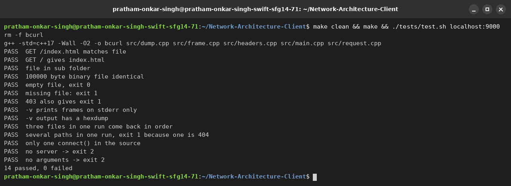
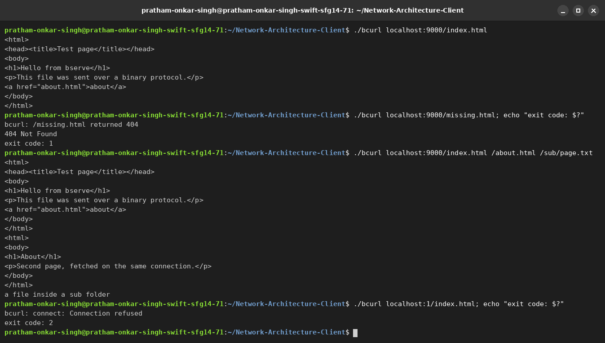
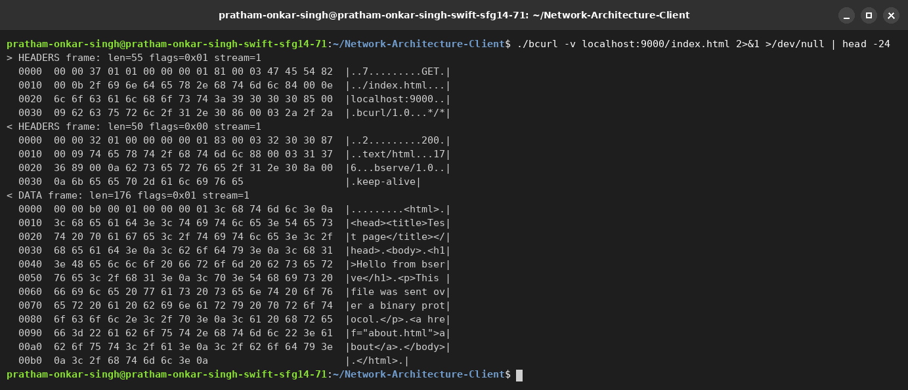

# bcurl (BHTTP-A client)

The client part of our course project "HTTP in binary". It builds a binary request frame for BHTTP-A, reads the
response and writes the body to stdout. The protocol is described in `SPEC.md`, and `HEXDUMP.md` has one request
and response with every byte explained. The client is written only from the spec, so it should work with any
server that follows it, not just ours.

## Build and run

    make
    ./bcurl localhost:9000/index.html
    ./bcurl -v localhost:9000/index.html
    ./bcurl localhost:9000/index.html /about.html

- the body goes to stdout, so `./bcurl localhost:9000/big.bin > big.bin` saves a file
- `-v` prints every frame that is sent and received to stderr, as one line and a hexdump
- paths after the first one are fetched on the same connection, the client never opens a second one
- if there is no port in the address, 80 is used

Exit code: 0 if every response is below 400, 1 if there was a 4xx or 5xx, 2 if it could not connect or the
response was broken.

## How it works

The client connects once. For each path it builds one HEADERS frame with `:method`, `:path`, `host`, `user-agent`
and `accept` and END_STREAM set, with the next odd stream id (1, 3, 5 ...). Then it reads frames until it sees
END_STREAM on that stream and writes the DATA payloads to stdout. Frames of unknown types and of other streams
are skipped.

## Code

| File | What is in it |
|------|---------------|
| `src/main.cpp` | arguments, address, the one connect, loop over the paths |
| `src/request.cpp` | builds the request frame, reads the response |
| `src/headers.cpp` | header block encoding and parsing, static table |
| `src/frame.cpp` | reading and writing whole buffers |
| `src/dump.cpp` | the `-v` output and the hexdump |
| `tests/test.sh` | tests |
| `www/` | copy of the server files, the tests compare with them |

## Tests

Start a server that serves the files in `./www` (ours or the partner's) and run:

    ./tests/test.sh localhost:9000

It compares downloaded files with the originals (also a 100000 byte file and an empty file), checks the exit
codes, checks that `-v` only writes to stderr and fetches several paths in one run.

## Cross test

Tested against Shreyash's server (`bserve ./www 9000`), all 14 tests pass.

## Screenshots

`make clean && make && ./tests/test.sh localhost:9000`, with the server running:

A normal request, a 404, three paths on one connection and no server:

`-v` prints every frame and a hexdump on stderr:

## Pair

This is the client for BHTTP-A. We wrote it as a pair:
Pratham wrote the client and Shreyash wrote the server, and the only thing we share is SPEC.md.

- client (this repo): https://github.com/Pratham-Onkar-Singh/Network-Architecture-Client
- server: https://github.com/Shreyash-Beyond-Journeys-End/NA-Project-Server
